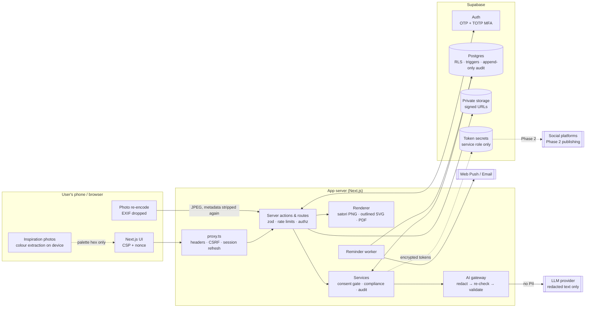

# Aesthetic OS

A calm, secure, mobile-first **business operating system for health & beauty solopreneurs**: estheticians, lash & brow artists, nail techs, hairstylists, massage therapists, med-spa owners, wellness coaches, makeup artists and yoga/pilates instructors.

It turns a personal aesthetic into a complete brand kit, generates on-brand social templates and posts, stages and schedules them, and includes **Muse**, an AI business assistant that ideates, validates claims, checks pricing and plans growth, all without client PII reaching an AI.

> **Try it with zero setup:** `npm install && npm run build && DEMO_MODE=true npm start`, then open http://localhost:3000 and choose **Explore the demo studio** (seeded "Luna Lash Studio" with 30 days of content) or **Start fresh** (onboarding).

---

## Contents
1. [What's included](#whats-included)
2. [Quick start](#quick-start)
3. [Production setup](#production-setup)
4. [Environment variables](#environment-variables)
5. [Threat model](#threat-model)
6. [Data flow](#data-flow)
7. [Privacy & compliance](#privacy--compliance-selling-globally)
8. [Architecture](#architecture)
9. [Testing](#testing)
10. [Roadmap](#roadmap)

---

## What's included

| Module | Highlights |
|---|---|
| **Onboarding** | 6 steps, ≤10 min. Niche presets pre-fill services. Moodboard cards (6 moods) plus up to 10 inspiration photos, whose colours are extracted **on the device** (photos are never uploaded). Region and currency come from the locale. Can draft the first week of posts. |
| **Brand kit** | Editable palette with hex/RGB and a WCAG 2.1 contrast report (auto-corrects text contrast). 8 OFL Google-Font pairings. Wordmark, monogram and icon logos in light and dark, as **outlined SVG** or PNG. Voice guide (tone, 10 do's/don'ts, sign-off, emoji policy). Bios for IG/TikTok/FB/LinkedIn/Google. Hashtag sets. Content pillars. Menu & price list, gift card, business card. One-page **PDF brand guide**. |
| **Template library** | 10 template types × 16 platform formats (IG feed/square/story/carousel, TikTok, FB feed/link/event, Pinterest, LinkedIn ×2, YouTube thumb/Shorts, X, Threads, Google Business). Brand elements are locked and slots are editable. The same JSX renders the live preview and the PNG export, so **a brand change re-themes every template and draft instantly**. |
| **Post engine** | Start from a pillar, service, photo, quick note or season. Captions are sized per platform, with hashtag caps, alt text, booking CTA and suggested time (in the studio's time zone). **Batch 30 days** with a balanced pillar mix. **Repurpose** one idea into a carousel, Reel/TikTok script, 4-frame Story sequence and pin. |
| **Staging & scheduling** | Kanban (Ideas → Drafts → Needs review → Approved → Scheduled → Published) with drag-and-drop plus a tap-friendly "Move to" on mobile, and **Approve & schedule all**. Week/month calendar with platform colours and drag-to-reschedule. Queue health (gaps, pillar balance, missing alt text/CTA, blocked items). The **Ready-to-Post package** has the PNG(s), copy-ready caption, alt text, open-app link, `.ics` alarm, and Web Push/email reminders. Manual metrics logging. |
| **Muse** | Docked on every screen. **Ideate** (content, campaigns, bundles, collabs, local), **Suggest** (next best actions with reasons, e.g. "You haven't posted a testimonial in 3 weeks"), **Validate** (claims compliance by region + brand consistency + optional AI rewrite), **Pricing** (hourly margin vs income goal), **Improve** (monthly review + 90-day plan), **Ask** (free-form, AI only), and an editable **"What Muse knows"** panel. Muse refuses medical advice and never publishes. |
| **Home ("OS")** | Today's posts, weekly focus (one goal, three tasks, progress ring), quick capture (photo or note becomes an idea, with PII stripped before saving), quick actions. |
| **Consent** | On-device client signature, plain-language consent text, alias only, scoped by use, platform, face and tagging, with expiry. SHA-256 evidence hash, immutable records, and one-tap withdrawal that cancels scheduled posts. |
| **Settings** | Connected accounts (encrypted tokens, minimal scopes, revocation), AI and client-data toggles, reminders, **full export (JSON + images)**, **permanent deletion with token revocation**, and the activity (audit) log. |

**It works with no paid services.** Without an AI key, Muse runs on a built-in, deterministic, offline engine (caption library, rules-based compliance, pricing maths). Adding `ANTHROPIC_API_KEY` upgrades writing and reviews.

## Quick start

Requirements: Node 20.9+ (22 recommended).

```bash
npm install
cp .env.example .env.local        # optional for demo mode
npm run build
DEMO_MODE=true SESSION_SECRET=$(openssl rand -base64 48) npm start
```

Demo mode keeps a per-visitor sandbox in memory. It resets after 6 hours or on restart and holds no real data. It's ideal as the public "try it" page for your product.

`npm install` also turns on the repo's pre-commit hook (`.githooks/pre-commit`), which blocks commits containing env files, keys, logs or likely secrets. Outside a git checkout this step does nothing.

## Production setup

Everything below has a free tier. You only pay once usage grows.

1. **Supabase project** (choose an EU region if most customers are in the UK/EU).
   - SQL editor: run `supabase/migrations/0001_init.sql`, then `0002_storage.sql`.
   - Auth → Providers → Email: enable, **turn off passwords** (OTP only), and set the email template to include `{{ .Token }}` (6-digit code).
   - Auth → Multi-factor: enable **TOTP** (the app requires it for every account).
   - Auth → Rate limits: keep the defaults or tighten them. Auth → Sessions: set an inactivity timeout (e.g. 7 days).
   - Optional local data: `npm run seed:sql` then run `supabase/seed.sql` (demo user `demo@aesthetic-os.local`).
2. **Secrets**: fill in `.env.local` / your host's env settings (see below). Generate keys with `openssl`.
3. **Host**: any Node host that runs Next.js 16 (Vercel, Netlify, Render, Railway, Fly, a VPS). Note that **Vercel's Hobby plan is for non-commercial use**. If you sell or run this commercially, use a plan or host that allows commercial use.
4. **Reminders**: schedule `GET /api/cron/reminders` every 5 minutes with `Authorization: Bearer $CRON_SECRET`. The free option is `supabase/cron.sql` (pg_cron + pg_net). Web Push needs VAPID keys (`npx web-push generate-vapid-keys`). Email needs Resend (optional). The `.ics` alarms work with no setup at all.
5. **Legal**: set `NEXT_PUBLIC_OPERATOR_*` and review `/privacy` and `/terms` with a lawyer for your markets.

## Environment variables

| Variable | Required | Purpose |
|---|---|---|
| `NEXT_PUBLIC_APP_URL` | yes | Public URL, used in reminder links and `.ics` files |
| `DEMO_MODE` | – | `true` = in-memory demo sandbox (also implied when no Supabase URL) |
| `NEXT_PUBLIC_SUPABASE_URL`, `NEXT_PUBLIC_SUPABASE_ANON_KEY` | prod | Supabase project (anon key is safe in the browser; RLS protects data) |
| `SUPABASE_SERVICE_ROLE_KEY` | prod | **Server only.** Cron worker, account deletion, token custody |
| `SESSION_SECRET` | yes | ≥32 chars; signs demo cookies |
| `TOKEN_ENCRYPTION_KEYS` | prod | `id:base64(32B)[,id2:…]`, AES-256-GCM for OAuth tokens. The first key encrypts and all keys decrypt (rotation) |
| `CRON_SECRET` | prod | Bearer secret for `/api/cron/reminders` |
| `ANTHROPIC_API_KEY`, `AI_MODEL`, `AI_PROVIDER` | – | Optional AI; default model `claude-opus-5-5`; `AI_PROVIDER=local` forces the offline engine |
| `NEXT_PUBLIC_VAPID_PUBLIC_KEY`, `VAPID_PRIVATE_KEY`, `VAPID_SUBJECT` | – | Web Push reminders |
| `RESEND_API_KEY`, `EMAIL_FROM` | – | Email reminders |
| `NEXT_PUBLIC_OPERATOR_NAME`, `NEXT_PUBLIC_PRIVACY_EMAIL`, `NEXT_PUBLIC_OPERATOR_ADDRESS` | sell | Shown in the privacy policy and terms |
| `TIKTOK_CLIENT_KEY`, `TIKTOK_CLIENT_SECRET` | – | TikTok token revocation (Phase 2 publishing) |

No secrets live in the repo. `.env*` is git-ignored, CI runs gitleaks, and nothing secret has a `NEXT_PUBLIC_` prefix.

## Threat model

Written before implementation and kept current. Scope: the web app, its database, file storage, AI gateway and scheduler.

### Assets
| Asset | Sensitivity |
|---|---|
| Client consent records (alias, signature, scope) and client photos | **High**: photos of treatment results can be health/biometric-adjacent data (GDPR Art. 9) |
| OAuth tokens for social accounts | **High**: account takeover / unauthorised posting |
| User account (email, MFA factors, sessions) | High |
| Business data (prices, goals, drafts, brand) | Medium: commercially sensitive |
| Audit log | Medium: integrity matters more than secrecy |
| AI prompts | Medium: could leak PII if unredacted |

### Threats → mitigations
| # | Threat (STRIDE) | Mitigation | Where |
|---|---|---|---|
| T1 | **Account takeover** via credential stuffing / phishing (S) | Passwordless email OTP, **mandatory TOTP MFA (aal2)** for all app routes, IP+email rate limits, exponential lockout on failed codes, no account enumeration | `app/actions/auth.ts`, `lib/auth/session.ts`, `lib/security/rate-limit.ts` |
| T2 | **Cross-tenant data access** / IDOR (I, E) | Postgres **RLS on every table** (`force row level security`), every query also scoped by `user_id`, ownership triggers stop attaching children to another user's posts, media paths prefixed by user id and checked server-side | `supabase/migrations/0001_init.sql`, `lib/db/*`, `lib/media.ts`; tested in `supabase/tests/rls_test.sql` |
| T3 | **PII leakage to the LLM** (I) | Single gateway; business-only context; recursive **redaction** (names, emails, phones, addresses, postcodes, DOB/dates, ages, IDs, cards, handles, health terms, known client aliases); second-pass check that aborts if anything remains; schema-validated output; provider without training on API data | `lib/ai/gateway.ts`, `lib/ai/redact.ts`; `tests/unit/redact.test.ts`, `tests/unit/gateway.test.ts` |
| T4 | **Token theft** (I) | AES-256-GCM with per-account AAD, keys from env with rotation, secrets table invisible to client roles (RLS on, no policies, privileges revoked), never sent to the browser, never exported | `lib/security/crypto.ts`, `lib/services/accounts.ts` |
| T5 | **Publishing client images without consent** (R, legal) | App-level gate **and** DB triggers block scheduling before/after posts without valid, unexpired, in-scope consent; withdrawal cascades (cancels schedules, moves posts to review); consent records are immutable evidence with a SHA-256 hash | `lib/services/posts.ts`, `lib/services/consent.ts`, migration triggers |
| T6 | **Location leakage via photo metadata** (I) | Browser re-encodes (drops EXIF), server strips EXIF/XMP/IPTC/text chunks again and verifies; inspiration photos never leave the device | `components/image-upload.tsx`, `lib/security/exif.ts` |
| T7 | **XSS / injection** (T, E) | React output encoding, nonce-based **strict CSP** (`strict-dynamic`, `object-src 'none'`, `frame-ancestors 'none'`), zod validation on every action/route, SVG signatures sanitised (allow-list check), user SVG never served from the app origin as HTML | `proxy.ts`, `app/actions/*`, `lib/services/consent.ts` |
| T8 | **CSRF** (T) | Server Actions are origin-checked by Next.js; API mutations require a same-origin `Origin` header; `SameSite=Lax` HttpOnly Secure cookies | `proxy.ts` |
| T9 | **Misleading health claims** published by the user (legal) | Region-aware rule pack (US/UK/EU/CA/AU/NZ) runs on every save; blocking rules prevent approval/scheduling; disclosure checks for paid/gifted/affiliate | `lib/compliance/*` |
| T10 | **Audit tampering / repudiation** (R) | Append-only audit log (no update/delete privileges), PII-free entries, user-visible | migration, `lib/security/audit.ts` |
| T11 | **Abuse / DoS** of expensive endpoints (D) | Per-user rate limits on actions, AI, uploads, renders and exports; upload size caps; cron endpoint behind a timing-safe bearer secret | `lib/action-ctx.ts`, routes |
| T12 | **Supply chain** (T) | Pinned lockfile, `npm audit` + Dependabot + gitleaks in CI, minimal dependencies, no third-party scripts or trackers | `.github/` |
| T13 | **Clickjacking / sniffing** | `X-Frame-Options: DENY`, `frame-ancestors 'none'`, `nosniff`, HSTS preload, COOP/CORP, tight `Permissions-Policy` | `proxy.ts`, `next.config.ts` |

**Residual risks / operator responsibilities:** in-memory rate limits are per instance (use Supabase Auth limits + a shared store for multi-region); Supabase and backups are trusted processors; users may still type PII into free-text fields, which is redacted for AI but stored in their own private rows; compliance rules reduce risk but are not legal advice.

## Data flow



Notes: the AI provider receives only redacted business context and the request. Notifications carry only a deep link. Exports never include tokens. Deletion revokes platform tokens, removes media, deletes all rows and deletes the auth user.

## Privacy & compliance (selling globally)

Aesthetic OS is built so one install can serve customers worldwide without adding friction:

- **Data protection**: the design follows GDPR/UK GDPR, CCPA/CPRA, PIPEDA, the Australian Privacy Act, LGPD and similar principles: data minimisation, purpose limitation, privacy by default (AI client-data access **off**), self-serve **access/portability** (export) and **erasure** (delete), transparent processing (activity log), and security by design. Only strictly necessary cookies are used (no consent banner needed, since there are no analytics or ad trackers). Fonts are self-hosted (no visitor IPs go to Google). The privacy policy and terms templates are at `/privacy` and `/terms`.
- **Special-category data**: client photos are processed only with recorded, explicit, withdrawable consent. Medical records, diagnoses and treatment notes are out of scope; users are told not to store them.
- **HIPAA**: if a US user is a covered entity (e.g. a med-spa under a medical director) and stores **protected health information**, HIPAA obligations apply, and the operator would need a BAA with the user and with sub-processors (Supabase offers HIPAA on paid plans; Anthropic offers BAAs for eligible API use). **Default stance: keep PHI out of the app.** There are no PHI fields, client data is alias-only, and the AI path is redacted.
- **Advertising rules**: Muse's rule pack covers FTC/FDA principles (US), CAP/ASA and the ban on advertising prescription medicines to the public (UK/EU/CA/AU/NZ), EU Cosmetics Regulation claim criteria, Australia's TGA code and AHPRA testimonial/before-after rules, and up-front `#ad` disclosures. Users pick their region once in onboarding.
- **Accessibility**: WCAG 2.1 AA target (helps with the European Accessibility Act): large tap targets, semantic landmarks, skip link, focus rings, reduced motion, contrast-checked brand colours, alt text by default.
- **AI**: choose a provider and terms where inputs aren't used for training. For stricter needs, request **Zero Data Retention** from Anthropic for your organisation. Muse never makes automated decisions with legal effect; users approve everything.
- **Selling the app**: production dependencies are MIT/Apache-2.0/BSD/ISC, plus `web-push` (MPL-2.0, used unmodified) and Next.js's optional image library `sharp`/libvips (LGPL-3.0, dynamically linked). Both are fine for commercial use. Fonts are SIL OFL. Keep licence notices when you redistribute the source.

## Architecture

```
app/
  (auth)/sign-in, mfa         passwordless OTP + mandatory TOTP
  (setup)/onboarding          guided intake → Brand Profile (+ first week)
  (app)/home brand templates posts board calendar ready muse consent settings
  actions/                    server actions (validated, rate-limited, audited)
  api/                        render PNG, logos, brand guide PDF, upload, media, export, ics, cron
lib/
  types.ts                    data model
  brand/                      colour/WCAG, moods, fonts, palette, voice, kit, logo, theme
  templates/                  formats, render.tsx (satori-compatible JSX), collateral, samples
  posts/                      platform rules, caption library, generator, batch, repurpose
  compliance/                 claims rules (by region), validation (consent, disclosures)
  muse/                       pricing, brand consistency, suggestions, ideas, monthly review
  ai/                         gateway, redaction, prompts, schemas, Claude provider
  services/                   business rules shared by demo + production (posts, consent, accounts)
  db/                         Store interface; Supabase (RLS) + memory (demo) adapters
  security/                   crypto, EXIF stripping, rate limiting, audit
  schedule/                   queue health, Ready-to-Post .ics
supabase/                     migrations (schema, RLS, triggers), storage, cron, seed
tests/                        unit (vitest), e2e acceptance (playwright), db (psql)
```

Data model: `User` (Supabase Auth), `BrandProfile`, brand assets (generated on demand from the profile, so they're always in sync), `Template` (code registry), `Post`, `PostVariant`, `ScheduleItem`, `ConnectedAccount` (+ `connected_account_secrets`), `ConsentRecord`, `AgentMemory`, `Task`, `Goal`, `MetricSnapshot`, `AuditLog`, plus `UserSettings` and `PushSubscription`.

## Testing

```bash
npm test            # 85 unit tests: redaction, AI gateway (no PII outbound), compliance set, security, engine
npm run test:db     # throwaway Postgres: RLS isolation, consent gate, revocation cascade, append-only audit, hidden secrets
npm run test:e2e    # Playwright acceptance tests in demo mode
npm run typecheck
```

Acceptance criteria → tests:

| Criterion | Test |
|---|---|
| Sign-up → brand kit + 7 scheduled posts in < 15 min | `tests/e2e/acceptance.spec.ts` › sign-up… |
| Brand colour change updates every template & draft | e2e › changing a brand colour… |
| No PII in outbound LLM requests | `tests/unit/gateway.test.ts`, `tests/unit/redact.test.ts` |
| Before/after can't be scheduled without consent | e2e › before/after…, `supabase/tests/rls_test.sql`, `tests/unit/compliance.test.ts` |
| Muse flags common risky claims | `tests/unit/compliance.test.ts` (≥90% of the risky set; all flagged today) |
| Export & delete end to end incl. token revocation | e2e › full export and permanent delete… |

## Roadmap

**Phase 2**
- Direct publishing through official APIs (Meta Graph for IG/FB business accounts, TikTok Content Posting, Pinterest, LinkedIn, Google Business Profile): OAuth connect flows, publisher adapters in the cron worker. Token custody, scopes, revocation and the `direct` schedule mode are already in place.
- Insights sync into `metric_snapshots`; richer analytics.
- AI-enhanced Improve mode (the monthly review and 90-day plan already ship rules-based).
- Passkeys (WebAuthn) as a second factor once enabled in Supabase Auth.
- Shared rate-limit store for multi-region deployments; i18n.
